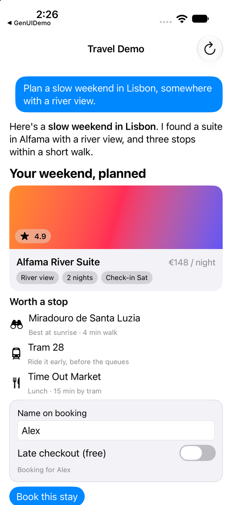

# SwiftA2UIHost

Native SwiftUI rendering for agent-built screens. An AI agent describes a screen in [A2UI](https://a2ui.org), Google's open format for agent UI, and your iOS app draws it with native views, including your own components. No web view. Zero dependencies.



- **A2UI 1.0**, the current spec. v0.9 messages are accepted too, and replies go back in the version the agent used.
- **All 18 standard components**, as native SwiftUI views, and **all 14 standard functions**, such as `formatCurrency` and `formatString`.
- **Your own components** under your own catalog id, mixed with the standard ones in one surface.
- **Conformance:** Google's 43 official 1.0 examples run end to end in the test suite.
- **Swift 6:** strict concurrency, tested under Thread Sanitizer. iOS 17+, macOS 14+, visionOS 1+.

## The problem

Apps can't ship a screen for every request a user makes to an agent: a comparison of three flights, a form for a one-off booking, a summary card with a button. A2UI lets the agent send that screen as data: components that reference each other by id, a data model they bind to, and actions that go back to the agent.

Google ships renderers for the web, Flutter and Android. A native iOS app that wants A2UI has to build the renderer itself:

- **Streaming state.** Components arrive over seconds, out of order, and refer to children that haven't arrived yet. The data model changes under them.
- **The expression layer.** Bindings, list templates, 14 functions, validation checks, function calls in both directions, and who may call what.
- **Native views that stay safe.** The agent's output is untrusted. URLs must be filtered, side effects must need a tap, and a bad payload must never crash the app or show raw JSON.

SwiftA2UIHost does all three, so adding agent-built screens to an iOS app is a store, a view and your catalog.

## Installation

In Xcode, choose File ▸ Add Package Dependencies, or add it to `Package.swift`:

```swift
.package(url: "https://github.com/zhaziragaripolla/SwiftA2UIHost.git", from: "1.0.0"),
```

Then depend on `SwiftA2UIHostUI`. Use `SwiftA2UIHost` alone for the protocol and state with no UI, for example on a server or in tests.

## Quick start

```swift
import SwiftUI
import SwiftA2UIHostUI

/// Holds every surface the agent has sent. Feed it the agent's bytes as they arrive.
@MainActor
final class AgentScreens {
    let store = A2UISurfaceStore()
    private var decoder = A2UILineDecoder()

    func receive(_ bytes: some Sequence<UInt8>) {
        store.apply(decoder.feed(bytes))   // any chunking: a message applies once its line is complete
    }
}

/// Your catalog: the standard components plus your own, under your own id.
/// `Stay` is your Decodable model and `StayCard` your SwiftUI view.
@MainActor
let catalog = A2UICatalog(id: "com.example.travel:catalog/1", including: .basic)
    .registering(A2UIComponentSchema(name: "StayCard", properties: [
        .init("name", .string, required: true),
        .init("price", .string),
    ])) { context in
        if let stay = context.props(as: Stay.self) { StayCard(stay: stay) }
    }

struct AgentSurface: View {
    let screens: AgentScreens
    let surfaceId: String
    let sendToAgent: (Data) -> Void

    var body: some View {
        A2UISurfaceView(store: screens.store, surfaceId: surfaceId, catalogs: [catalog]) { action in
            // Taps become messages for the agent. Side effects such as openUrl are yours to allow.
            if let message = action.messageToAgent, let data = try? message.encoded() {
                sendToAgent(data)
            }
        }
    }
}
```

Two more things to wire up:

- **Tell the agent what it can use.** `catalog.manifest(version: "1").agentInstructions()` is text for its prompt. `rendererCapabilities` is the A2UI capabilities object your transport sends.
- **Send the store's own replies.** Set `store.onMessageToAgent` to deliver answers to the agent's function calls, and errors such as a duplicate surface.

These snippets are compiled and run in the test suite (`Tests/SwiftA2UIHostTests/ReadmeSnippetTests.swift`).

## What you get

| | |
|---|---|
| **Streaming** | Feed bytes in any chunking. Children that haven't arrived show as placeholders, and updates that arrive before their surface are held. |
| **Bindings** | `{"@path": "/stay/name"}` reads the data model, and input components write back to it. Templates repeat a component for each item of a list. |
| **Functions** | Formatting, validation and logic run on the device. Functions your app doesn't implement go to the agent as `callAgentFunction`. Register your own with `A2UIFunctionRegistry`. |
| **Validation** | `@checks` disable a button and show messages under inputs until the data is valid. |
| **Mixed catalogs** | Each component is drawn by the catalog its `@catalogId`, or the surface's default, names. `allowedParents` and `allowedChildren` are enforced. |
| **Older app builds** | Components carry versions and fallbacks. `A2UIDowncompiler` rewrites a surface for a build that can't render something new ([RFC-002](Docs/RFCs/RFC-002-catalog-versioning-fallbacks.md)). |
| **Accessibility** | `@accessibility` labels and hints reach VoiceOver. Markdown headings are marked as headers. |

## Security model

The agent's output is treated as untrusted:

- **Functions:** the agent can't call functions marked `rendererOnly`. Functions that need a user gesture, such as `openUrl`, run only from a tap and never from a binding or a check.
- **Links:** `openUrl` accepts only `http` and `https`, and the app decides whether to open it.
- **Media:** URLs must be `https://host`, `http://host`, `data:` or a same-host relative path, checked the way browsers parse them.
- **Patterns:** `regex` checks reject constructs that can backtrack for a long time.
- **Size:** tree size, nesting depth, expression nesting and line length are capped.
- **Bad input:** a malformed message or component is skipped and reported in `diagnostics`. The rest of the surface still renders.

## Limits

- **Not a transport.** Bring your own connection to the agent: SSE, WebSocket, A2A or plain HTTP.
- **Icons given as `svgPath`** show a placeholder symbol.
- **Strict schema validation** isn't run. Unknown properties are ignored, which the spec allows.
- **Agent functions** are called from actions only, not from passive bindings.
- [RFC-003](Docs/RFCs/RFC-003-a2ui-1.0.md) lists every gap.

## Example

[`Examples/TravelDemo`](Examples/TravelDemo) streams a surface from a scripted agent, with no network and no API key. It shows a custom `StayCard`, a list template, a validated form and a booking round trip.

```bash
cd Examples/TravelDemo && xcodegen generate && open TravelDemo.xcodeproj
```

## Related

- **MCP Apps** (interactive HTML from MCP servers) is a different format. Use [SwiftMCPAppHost](https://github.com/zhaziragaripolla/SwiftMCPAppHost). Neither package depends on the other, and this one never loads WebKit.
- **Streaming the text answer** around a surface at 120 Hz: [FluidStreamKit](https://github.com/zhaziragaripolla/FluidStreamKit).

## For AI coding assistants

- [`llms.txt`](llms.txt) describes the package for language models.
- A Claude Code plugin with a skill for this package is in [`plugins/swift-a2ui-host`](plugins/swift-a2ui-host). Install it with:

```
/plugin marketplace add zhaziragaripolla/SwiftA2UIHost
/plugin install swift-a2ui-host@swift-a2ui-host
```

## Design

- [RFC-001](Docs/RFCs/RFC-001-native-a2ui-host.md): the host's architecture.
- [RFC-002](Docs/RFCs/RFC-002-catalog-versioning-fallbacks.md): catalog schemas, versions and fallbacks.
- [RFC-003](Docs/RFCs/RFC-003-a2ui-1.0.md): A2UI 1.0, and the known gaps.

## Development

```bash
swift test
```

## License

MIT. See [LICENSE](LICENSE). The A2UI example fixtures in `Tests/SwiftA2UIHostTests/Fixtures` are Google's, under Apache-2.0.
